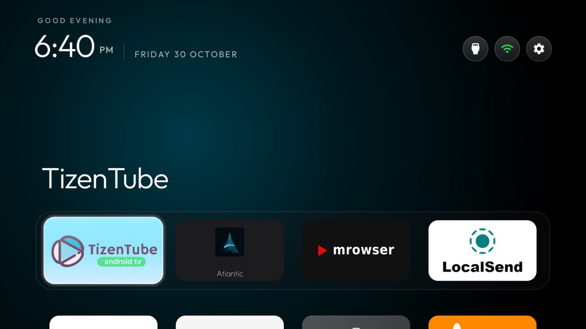

# r4g-home — this TV's working config

The full launcher config our Acer R4G runs. `config.json` here is **byte-identical to the file on the
TV**, so pushing this folder restores the exact look, and editing it is how the TV gets changed.



## Apply / undo

```sh
TV_HOST=192.168.1.19 tools/theme.sh themes/r4g-home    # push it and restart Home
TV_HOST=192.168.1.19 tools/theme.sh --reset            # back to the launcher's built-in config.xml
```

`tools/theme.sh` only reads `config.json` — `screenshot.jpg` is here so you can see the result first,
the way every folder in [`themes/`](../) is.

## Every key in it

| Key | Value | Why |
|---|---|---|
| `dock_apps` | TizenTube, Atlantic, Mrowser, LocalSend | The four apps that belong on Home; Settings and Play Store stay in the grid below. |
| `icon_only_buttons` | `true` | Wi-Fi and Settings as round icon buttons; Inputs keeps its label. |
| `icon_only_inputs` | `true` | Inputs round too — it has its own key, `icon_only_buttons` does not cover it. |
| `wifi_label_width` | `0` | Icon only, no network name. **Pinned deliberately:** `Config` reads this from the installed APK's resources *before* overlaying `config.json`, and that build's default is non-zero, so the Wi-Fi pill kept its label until the value was written here. |
| `wifi_status_color` | `true` | The Wi-Fi icon tints with the connection instead of always white: green while online, white while it is not (needs a rebuild, see below). |
| `wifi_status_warnings` | `true` | Refines the tint: orange while a connection exists but is not usable yet — no internet, still connecting, or Wi-Fi on with nothing associated — and red only while the Wi-Fi radio is off, so a reconnect does not flash red. |
| `settings_key_panel` | `true` | Settings opens the small glass panel (TV settings, Display, Network, Apps, Launcher settings) instead of the full TV Settings. The remote's Settings key already reads this; the on-screen gear needs the rebuilt APK below. |
| `dock_opacity` | `30` | The dock band at 30% opacity, so the wallpaper shows through it. A value picked in Launcher settings still wins until the next `tools/theme.sh` push, which clears the pick (100, 70, 50 or 30 are its options). |
| `stock_home_redirect` | `com.google.android.apps.tv.launcherx` | Stock Home stays on `launcherx` — this firmware re-enables it every cold boot — and sends its home screen straight back to this launcher. |
| `home_idle_clock_minutes` | `10` | Clock screensaver after 10 idle minutes on Home (`0` = off). |
| `hidden_apps` | 16 packages | Live TV, USB media player, meeting mode, System upgrade, and everything the firmware re-enables at a **cold** boot (Prime Video, Play Games, esticker, gdpr, scast, fastscreen, timeclock, …). Hiding is what survives a reboot; `pm disable-user` alone does not. |

## Not in this file

Two things that make the setup work live outside `config.json` — they are in Settings and in the
accessibility service, so a theme push cannot set them. Both are in [`MYTV.md`](../../MYTV.md):

- **System screensaver** → `settings_key_panel` is not it; Android's dream is `screensaver_components`
  (step 4b). Ours points at `com.gathin.tvhome/.ClockDream`, not Google's Backdrop.
- **Home key service** → `HomeKeyService` must be bound (step 5), or the remote's Home button opens
  the stock launcher instead of this one.

## The round gear and the glass panel

`settings_key_panel` was honoured by the remote's Settings key but **not** by the on-screen gear: the
gear's `setOnClickListener` called the full TV Settings unconditionally. `MainActivity` now checks the
flag first, which needs a rebuild — `tools/docker-build.sh launcher assembleRelease`, no local JDK.
See [`ISSUES.md`](../../ISSUES.md) for the install-signature caveat that goes with replacing the APK.
